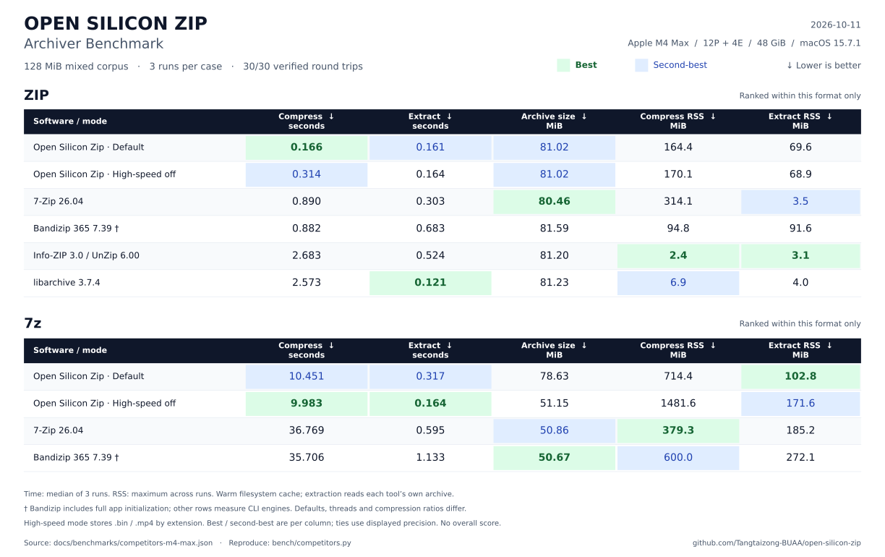

# Benchmark / 性能实测

本页记录 2026-10-11 在 Apple M4 Max（12P + 4E，48 GiB，macOS 15.7.1）上的本机测量。
所有输入均由固定随机种子生成，不包含个人文件。数据与脚本一并公开；不分发 Bandizip 或其他软件的二进制。

## preview.2 优化前后

同机比较 `v0.2.0-preview.1`（提交 `1b378e6`）与 `v0.2.0-preview.2` 的 ARM64 release 引擎：每项先预热，再交替执行五轮，报告中位数；**70 次计时往返全部通过逐文件路径、长度与 SHA-256 校验**，另有 14 次预热往返校验。没有同时运行其他构建或测试；没有锁定机器热状态或清空缓存。

| 工作负载 | 旧版压缩 ms ↓ | 新版压缩 ms ↓ | 旧版解压 ms ↓ | 新版解压 ms ↓ |
|---|---:|---:|---:|---:|
| ZIP · 32 KiB · JSON | 162.4 | **18.9** | 167.5 | **9.8** |
| 7z · 32 KiB · JSON | 166.1 | **17.7** | 165.9 | **10.1** |
| ZIP · 32 KiB · CLI | 162.3 | **17.2** | 167.7 | **10.3** |
| ZIP · 64 MiB 单文件 | 162.0 | **87.2** | 163.9 | **81.1** |
| ZIP · 128 MiB 混合 | 163.8 | **115.8** | 162.7 | **47.7** |
| 7z · 128 MiB 混合 | 10142.1 | **9978.3** | 316.5 | **202.4** |
| 7z PPMd · 2 MiB | 774.7 | **745.7** | 315.2 | **54.0** |

**粗体为同一工作负载、同一操作的最低中位数。** 计时包含引擎进程启动、压缩/解压、写出及进度线程收尾，不含 SwiftUI/Finder 或内容校验。小文件的大幅改善主要来自去除最多 150 ms 的收尾等待，不能解释为压缩算法提速十倍。混合 7z 压缩的约 1.6% 差异不视为明确提升；其解压耗时下降约 36%。PPMd 解压下降约 83%，同时受输入缓冲和收尾等待修复影响，没有单独归因实验。

### 输出大小与内存

下表内存取五轮最大峰值 RSS，单位 MiB；箭头为旧版 → 新版，**不表示一律改善**。

| 工作负载 | 两版输出大小 bytes | 压缩 RSS MiB | 解压 RSS MiB |
|---|---:|---:|---:|
| ZIP · 32 KiB · JSON | 455 | 5.4 → 5.3 | 5.0 → 5.0 |
| 7z · 32 KiB · JSON | 312 | 86.6 → 8.8 | 21.4 → 5.4 |
| ZIP · 32 KiB · CLI | 455 | 5.4 → 5.4 | 4.9 → 5.0 |
| ZIP · 64 MiB 单文件 | 18,491,342 | 53.1 → 50.8 | 86.7 → 86.7 |
| ZIP · 128 MiB 混合 | 84,952,303 | 162.5 → 165.7 | 71.0 → 71.2 |
| 7z · 128 MiB 混合 | 82,453,450 | 715.5 → 712.5 | 96.4 → 98.3 |
| 7z PPMd · 2 MiB | 412,540 | 12.4 → 12.5 | 11.4 → 11.3 |

七项输出大小均保持一致；除小 7z 因默认字典元数据变化外，其余六项压缩包逐字节相同。小 7z 压缩 RSS 下降约 90%；混合 ZIP 压缩 RSS 从 162.5 增至 165.7 MiB、混合 7z 解压从 96.4 增至 98.3 MiB，没有宣称所有工作负载内存下降。库接口显式指定的字典设置保持不变。

输入是固定种子的合成数据：32 KiB 文本；64 MiB 单文件为 1 MiB 词块重复 64 次；混合数据沿用下文的 128 MiB 语料；PPMd 为同一词块重复两次。除标注 PPMd 外，均使用默认 normal 等级和默认高速模式；小 CLI 项无 `--json`，其他项有。每个解压器读取自己生成的压缩包。

[全部原始样本、输入与二进制 SHA-256](benchmarks/performance-round2.json) · [复现脚本](../bench/latency.py)

```sh
python3 bench/latency.py /path/to/preview1/fz /path/to/preview2/fz \
  --repetitions 5 --output performance-round2.json
```

## 软件间历史对照

以下软件间对照保留优化前版本的三轮实测，**没有把新版结果与旧的竞品样本拼成新排行榜**。

### 对照方法

- 同一份 128 MiB、128 文件的混合语料：64 MiB 文本、32 MiB 重复二进制、32 MiB 随机媒体形状数据。这些是合成数据，不是真实视频、源代码仓库或通用行业语料。
- 随机种子为 714；每个文件 1 MiB。`.bin` 文件由同一个 128 KiB 随机块重复八次组成。
- 每项三轮，报告耗时中位数和各轮最大峰值 RSS；轮换执行顺序；不清空文件系统缓存。输入生成和内容校验不计入计时。
- 计时边界为 Python `perf_counter` 包围 `/usr/bin/time -l` 子进程，包括进程启动、读取、编码/解码与写出。各工具自己的刷盘策略保留。macOS `time -l` 的 RSS 原值单位是字节。
- 每轮完整解压，逐文件校验路径、长度与 SHA-256，并用 7-Zip `t` 校验压缩包。表中的解压时间对应**各软件自己生成的压缩包**，不是对同一个压缩流的解码竞速。
- 7-Zip 为 `-mx=5`；Info-ZIP 为 `-6`；libarchive 使用 ZIP 默认 Deflate；Open Silicon Zip 使用 normal。线程、字典和 solid block 保留各软件默认策略，**不代表相同算法参数**。
- Bandizip 365 7.39 通过其[官方 macOS 命令行接口](https://en.bandisoft.com/bandizip.mac/help/parameter/)启动，使用 `-l:5 -y`。它执行的是完整应用进程，计入应用初始化；其他行是命令行引擎进程。因此尤其不能将亚秒级 ZIP 的差值直接解释为 GUI 体验或纯算法的倍数提升。Bandizip RSS 也包含应用运行时开销。
- Open Silicon Zip 默认高速模式按扩展名直接存储 `.bin` 和 `.mp4`。这里的 `.bin` 可被大字典压缩，因此另外报告 `--high-speed off`，展示速度与压缩率的取舍。关闭高速模式的两项在默认组之后单独执行，同样各三轮。

## 测量结果



[下载高清 PNG](benchmarks/comparison.png) · [SVG 矢量图](benchmarks/comparison.svg) · [图表生成脚本](../bench/render.py)

**测试环境：M4 Max · 12P + 4E · 48 GiB · macOS 15.7.1**

**评测规模：128 MiB / 128 个文件 · 每项 3 轮 · 30/30 次往返校验通过**

**粗体 = 同格式、同列的最优实测值**；所有数值列均为 **↓ 越低越好**。耗时取三轮中位数，内存取三轮最大峰值。不跨 ZIP / 7z 评选最优，也不合成缺乏依据的总分。

### ZIP 排行榜

| 软件 / 模式 | 压缩时间 s ↓ | 解压时间 s ↓ | 压缩包 MiB ↓ | 压缩内存 MiB ↓ | 解压内存 MiB ↓ |
|---|---:|---:|---:|---:|---:|
| Open Silicon Zip · 默认 | **0.166** | 0.161 | 81.02 | 164.4 | 69.6 |
| Open Silicon Zip · 高速模式关闭 | 0.314 | 0.164 | 81.02 | 170.1 | 68.9 |
| 7-Zip 26.04 | 0.890 | 0.303 | **80.46** | 314.1 | 3.5 |
| Bandizip 365 7.39 † | 0.882 | 0.683 | 81.59 | 94.8 | 91.6 |
| Info-ZIP 3.0 / UnZip 6.00 | 2.683 | 0.524 | 81.20 | **2.4** | **3.1** |
| libarchive 3.7.4 | 2.573 | **0.121** | 81.23 | 6.9 | 4.0 |

### 7Z 排行榜

| 软件 / 模式 | 压缩时间 s ↓ | 解压时间 s ↓ | 压缩包 MiB ↓ | 压缩内存 MiB ↓ | 解压内存 MiB ↓ |
|---|---:|---:|---:|---:|---:|
| Open Silicon Zip · 默认 | 10.451 | 0.317 | 78.63 | 714.4 | **102.8** |
| Open Silicon Zip · 高速模式关闭 | **9.983** | **0.164** | 51.15 | 1481.6 | 171.6 |
| 7-Zip 26.04 | 36.769 | 0.595 | 50.86 | **379.3** | 185.2 |
| Bandizip 365 7.39 † | 35.706 | 1.133 | **50.67** | 600.0 | 272.1 |

† Bandizip 计入完整应用初始化，其他行是 CLI 引擎；线程、分块和压缩率不同，最优标记仅表示本次实测该列最低值，不能等同于纯算法排名或所有场景领先。

耗时越低越好；MiB = 1,048,576 字节。峰值 RSS 是进程驻留内存，不能等同于系统整体内存占用。

实测工具：Open Silicon Zip 0.2.0 的 ARM64 release 引擎、7-Zip 26.04、Bandizip 365 7.39、系统 Info-ZIP 3.0 / UnZip 6.00、bsdtar 3.5.3（libarchive 3.7.4）。

全部 **30 次压缩 + 30 次解压**通过逐文件校验和 7-Zip 完整性测试。语料校验和：`f57346b3d68079c621e4ed9ec9dc9265d8fed1cb6b7e5afa00b4fc41cbc0cf15`。

原始样本与精确参数：[competitors-m4-max.json](benchmarks/competitors-m4-max.json)；复现脚本：[competitors.py](../bench/competitors.py)。

### 如何解读

- ZIP：本项目默认压缩耗时为 0.166 秒，7-Zip 为 0.890 秒；输出分别为 81.02 和 80.46 MiB。libarchive 在本次自己生成的 ZIP 上解压最快（0.121 秒）。Bandizip 的亚秒级结果包含应用启动，不作为纯编码器倍速结论。
- 7z：关闭高速模式后，本项目为 9.983 秒、51.15 MiB，7-Zip 为 36.769 秒、50.86 MiB，Bandizip 为 35.706 秒、50.67 MiB。本项目输出比后两者分别大约 0.58% 和 0.96%。
- 内存代价：上述完整 7z 压缩中，本项目峰值 RSS 约 1.45 GiB，7-Zip 约 379 MiB，Bandizip 约 600 MiB。多分块并行用更多内存换取吞吐；不适合据此宣称在所有维度领先。
- 默认 7z 的 78.63 MiB 包更大，源于 `.bin` 的直接存储策略。关闭高速模式在这个语料上能明显缩小输出；两种模式的微小耗时差不能推广为“关闭高速模式总是更快”。

## 复现

先构建 ARM64 release 引擎，安装官方 7-Zip 命令行工具（Homebrew `sevenzip`）。Info-ZIP 和 bsdtar 使用系统自带版本。若安装了 `/Applications/Bandizip365.app`，脚本会加入它；否则不会伪造该项结果。Bandizip 需要本机可用、具备合成工作目录访问权限。运行期间不要同时进行其他压缩任务。

```sh
cargo build --locked --release --manifest-path engine/fz-core/Cargo.toml
python3 bench/competitors.py --output competitors.json
# 指定 Bandizip 能访问的父目录（脚本只删除自己创建的临时目录）：
python3 bench/competitors.py --work-parent /path/to/benchmark-parent --output competitors.json
# 只测选定项：
python3 bench/competitors.py --cases osz-7z-full,7zip-7z,bandizip-7z --output sevenzip.json
```

脚本遇到非零退出、未完成输出、解压内容不一致或7-Zip 校验失败时直接失败，不会把失败任务当作速度样本。完整输入生成器、命令参数、每次原始耗时、压缩包大小与 RSS 均可查阅。机器电源/热状态没有锁定，也没有冷盘测试；不要将这个小规模合成测试外推到所有 Apple 芯片或工作负载。

## 本项目优化前后

原始实现与首个公开版本的同机对照见 [validation](VALIDATION.md#performance)，原始数据见 [m4-max.json](benchmarks/m4-max.json)，脚本为 [compare.py](../bench/compare.py) 和 [large-store.py](../bench/large-store.py)。

128 MiB 混合数据的 7z 吞吐约为原实现的 4 倍，同时峰值内存增大；512 MiB ZIP store 的峰值 RSS 下降约 55%。这些是优化前后结果，不能替代上方的软件间对照。

## English notes

This is a three-repeat, warm-cache synthetic benchmark, not a universal ranking. Compression time, extraction time, output size and memory must be read together. Each extractor reads its own producer's archive. Defaults differ across codecs, thread counts and solid-block layouts. Bandizip runs through its documented macOS command interface and includes full app initialization; other rows measure CLI engines. Open Silicon Zip's default extension-based store policy is shown separately from high-speed-off mode. All extracted files are checked byte-for-byte via SHA-256, and every archive is tested with 7-Zip.
